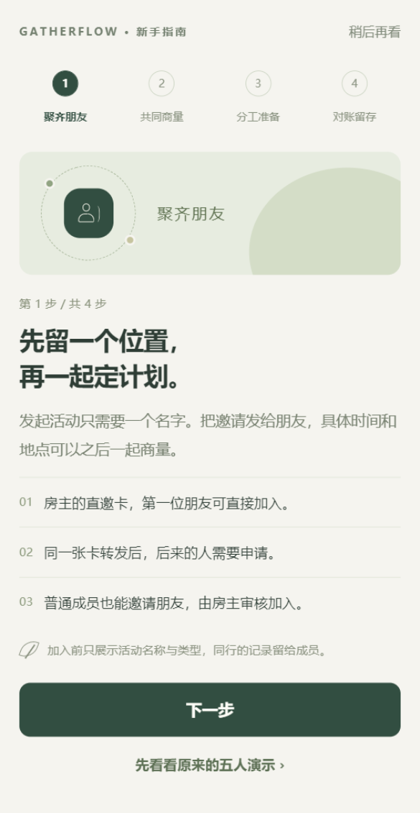
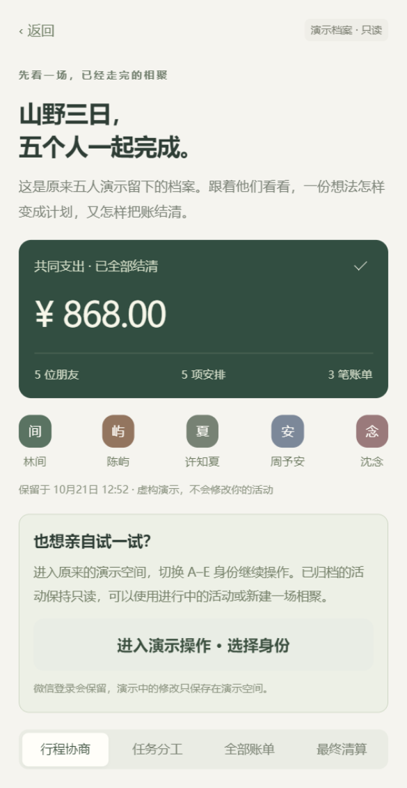

# 演示入口与新人指南

2026-10-21 更新。微信身份版本现在提供两个演示入口：原来的五人只读档案，以及可切换 A–E 身份继续操作的演示空间。小程序共 21 个页面。

## 在小程序中使用

首页相聚卡下面、登录页底部和“我的”都有“先看看，朋友们怎样一起出发”。点开后能查看原有五人演示的行程协商、任务交接、三笔账单、¥868.00 最终清算和四笔到账记录。账单和方案可以点开，查看分摊、表态、限制、留言与异议。这个档案是原演示活动的保存副本，不需要登录或联网。

要继续操作原来的演示数据，在档案页点击 **“进入演示操作 · 选择身份”**，再选择林间 A、陈屿 B、许知夏 C、周予安 D 或沈念 E。此时连接原演示数据库；可在“进行中”使用已有活动，或新建活动体验操作。“已归档”里的活动仍然只读，这是原有的归档规则。

演示页面顶部会显示“正在操作演示空间”。点击 **“返回微信活动”**，会恢复此前保留的微信身份；如果微信会话已过期，则正常重新登录。演示修改不进入微信活动，两个空间的数据不会合并。

演示中的邀请用“复制这张邀请”和切换身份测试。要邀请真实微信朋友，先返回微信活动；演示空间的菜单分享只展示公开的只读五人档案，避免朋友在微信身份空间打开演示数据库的邀请。

首次进入首页时会出现新人提示。点开 **新手指南**，按聚齐朋友、共同商量、分工准备、对账留存四步了解使用方法。支持上一步、下一步和稍后再看；完成或跳过后不再自动提示。之后仍可从“我的 → 新手指南”或登录页再次查看。邀请登录后的回跳路径继续保留。

## 本地运行

微信版本仍导入 `apps/miniapp/dist/wechat/mp-weixin`。保持两个 API 分别运行：

```powershell
# 终端一：微信身份，默认 3003，独立数据库
npm run dev:wechat-api
# 终端二：原演示数据，默认 3001
npm run dev:api
# 构建更新后，在工具中重新编译
npm run build:wechat
```

更新产物后在开发者工具使用 **工具 → 编译（Ctrl+B）** 做一次完整编译。仅热重载页面可能混用旧 `vendor.js` 与新页面，表现为 `e.split is not a function` 或返回页面空白；完整编译后再运行回归。

`apps/miniapp/.env.wechat` 增加 `VITE_DEMO_API_BASE_URL=http://127.0.0.1:3001`。只有配置演示地址才提供可操作入口；将该变量在 `.env.wechat.local` 中置空并重新构建，可隐藏操作入口，只保留离线档案。发布环境不应连接本机演示 API，服务端的生产环境仍禁止 demo 身份认证。

真机调试时，主 API 和演示 API 都需要手机可访问的地址；分别设置 `VITE_API_BASE_URL` 和 `VITE_DEMO_API_BASE_URL`，并处理对应网络及微信域名配置。后端的 AppSecret 继续只保存在服务端本地配置，不能加入前端变量。

## 身份和请求边界

- 会话按身份模式和完整 API 地址分别缓存；原单会话仅迁移到原构建对应的空间。清除过的会话不会从旧缓存复活。
- 进入前先无令牌检查演示服务 `/health`，只有明确声明 demo 模式才切换。断网、地址错误或误指向微信 API 时保留当前空间和登录。
- 每次请求固定记录发起时的地址、身份和空间版本。切换后，旧成功响应不更新新页面；旧 401 不清除另一空间的会话；旧图片下载不会弹出到新空间。
- 切换会清空页面栈。待提交表单不会带到另一空间；晚返回的登录请求不会覆盖当前身份。
- 微信 API 仍拒绝 demo 会话，demo API 仍拒绝微信会话。前端空间切换不代替服务端认证。

## 档案来源与复测

`apps/miniapp/src/content/demo-preview.json` 来自本机已有、已归档的五人演示活动。导出仅保留展示字段，不含登录令牌、邀请路径、openid、密钥或图片地址。更新档案时，先完成 `npm run wechat:test` 生成已归档演示记录，再运行 `npm run demo:export`；导出脚本拒绝未归档活动、非演示活动、非 A–E 成员和未结清数据。

自动化检查使用已配置的微信身份构建及本地双 API：

```powershell
$env:WECHAT_PROJECT_PATH = Join-Path $PWD 'apps/miniapp/dist/wechat/mp-weixin'
$env:WECHAT_AUTO_PORT = '9423'
npm run wechat:guide-test
```

已有自动化连接时可设置 `WECHAT_WS_ENDPOINT=ws://127.0.0.1:9423`。结果和截图在 `output/wechat-onboarding/`；脚本会新增一个明确命名的演示活动，以验证实际写入与空间隔离，不重置旧活动。它会恢复测试前的新人提示偏好。脚本使用真实 WXML/input 事件和 HTTP，验证方法与 [微信回归记录](verification-wechat.md) 一致，不能替代真机触屏验收。

## 本次验证记录

2026-10-21 19:35（北京时间），在 Windows、微信开发者工具 2.01.2510290、基础库 3.17.4 上，`wechat:guide-test` 的六项检查全部通过：

- 四步指南、上一步、完成并记录已读；从“我的”重新打开，跳过后返回原页。
- 从真实入口查看原五人 ¥868 档案，切换账单与清算；查看档案保持原微信会话。
- 同一个微信构建进入演示操作，A 访问原演示数据库的已归档活动。
- A 经真实输入事件与提交按钮新建演示活动，切换 B 后仍可读取原五人档案。
- 顶部退出按钮恢复同一微信用户与同一应用会话令牌；个人活动接口返回 200，新建演示活动未进入个人活动列表。

验证脚本新增的虚构活动为 `30458d44-c1bd-4bde-9a2b-41394e94f55b`，仅存在本地演示数据库。输出记录 `output/wechat-onboarding/result.json` 不包含令牌或密钥。自动化等待原生页面转场完成后再点击，避免开发者工具中连续操作导致导航超时。

全仓库类型检查、96 项测试、API 构建、独立演示小程序构建、微信身份小程序构建和 H5 构建均通过。真机触屏、分享发送与手机网络仍按原验收清单保留。

随后再次运行 `wechat:login-test` 通过：两次真实微信登录保持同一用户，微信登录页没有 A–E 按钮，真实会话读取活动列表返回 200。演示身份选择只在进入演示空间后显示。




