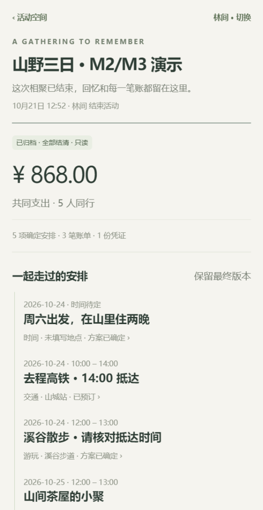

# 微信接入与模拟器回归记录

验证日期：2026-10-20 至 2026-10-21。基于 M5，在 `codex/wechat-integration` 实现。环境为 Windows、Node 22.18.0、微信开发者工具 2.01.2510290、基础库 3.17.4。

## 本次完成

- 接通 `uni.login → 服务端 code2Session → 应用会话`，支持安全错误映射、超时、请求频率限制、AppID 身份与会话隔离。密钥只在被忽略的服务端本地配置中。
- 拆分演示与真实微信身份的构建目录、API 端口和数据库，提供启动、构建及登录复测命令。
- v5/v6 增量迁移保留已有演示活动，补充从 v5 数据库升级的回归测试。
- 修复原生图片预览失败时未向页面返回错误的问题；补充相册取消/权限、上传断网/旧身份 401、鉴权下载与预览失败测试。

## 实测证据

2026-10-20 的模拟器回归通过实际渲染按钮的 WXML 事件执行，真实请求本地 API 并写 SQLite，原生确认弹窗由 SDK 确认。覆盖 A 登录回跳并确认停车费、B 无房主入口、冻结 ¥868.00、未到账重开并再次冻结、B 无收款确认入口、A 逐笔确认四笔虚构收款、到账后不能重开、结束归档以及归档后变更入口消失。2026-10-21 再次复测，并验证原生分享回调返回服务端准备的邀请路径、下一次使用新卡；没有向联系人发送分享。

2026-10-21 使用项目提供的 AppID 与本地密钥，连续两次点击真实微信登录按钮，均进入首页且复用同一内部用户；使用得到的应用会话读取活动列表返回 200。微信版本没有五个演示身份按钮。结果在 `output/wechat-login/result.json`，没有保存密钥、openid、code 或会话令牌。

模拟器财务截图：



## 自动化方法与边界

本工具版本的 `Page.getElements`、Element 和 Page 数据接口持续无响应。官方 SDK 的 `evaluate` 可用，因此 `scripts/wechat-driver.ts` 用原生 `wx.createSelectorQuery` 验证可用元素，从本次构建 WXML 解析绑定，再触发真实页面/组件事件。没有注入业务状态、替换 API 返回、写入会话或模拟确认结果。WXML 绑定变化时脚本明确失败，需要重新检查编译产物。

该回归验证模拟器事件、页面状态、原生弹窗、HTTP 和数据库链路；触屏命中、手势与手机硬件行为仍需真机验证。截图命令本身只采集画面，独立于业务回归命令。

开发者工具曾缓存旧 JS 与新 WXML，导致按钮绑定不一致。按 [工具排查步骤](wechat-demo.md) 重置本项目索引和编译缓存、关闭后先 open 再 auto，重新编译后恢复。另一个失败源是选择器 `button.btn` 在当前原生查询中没有匹配，改用 `.btn` 后真实登录回归通过。

## 复现

```powershell
npm run check
npm run build:h5
npm run build:wechat
# 另一个终端保持 npm run dev:api 运行，工具中使用演示构建
npm run wechat:test
# 微信身份模式的配置与复测见 wechat-login.md
```

`wechat:test` 会创建新的虚构五人活动，输出截图与脱敏验证记录到 `output/wechat-regression/`，不会重置已有活动。真实登录需要 `npm run dev:wechat-api`，使用独立微信构建。全仓 strict 类型检查、81 项测试、API 与演示小程序构建均通过；H5 和独立微信身份构建也分别检查。

## 仍待设备验收

真机原生分享发送/转发、手机照片权限与相机、真机弱网及布局尚未验证；接入步骤和逐项预期见 [微信登录与真机准备](wechat-login.md)。当前没有公网部署、体验版上传或发布。真实登录的模拟器验证已经完成，不能将其扩大为手机验收通过。
