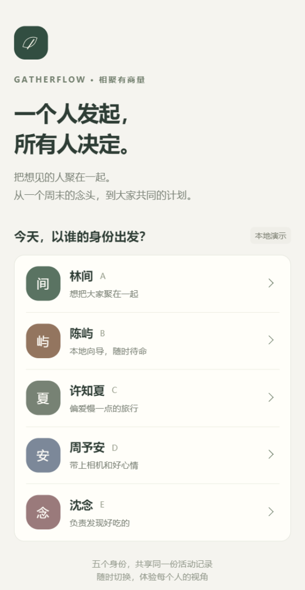
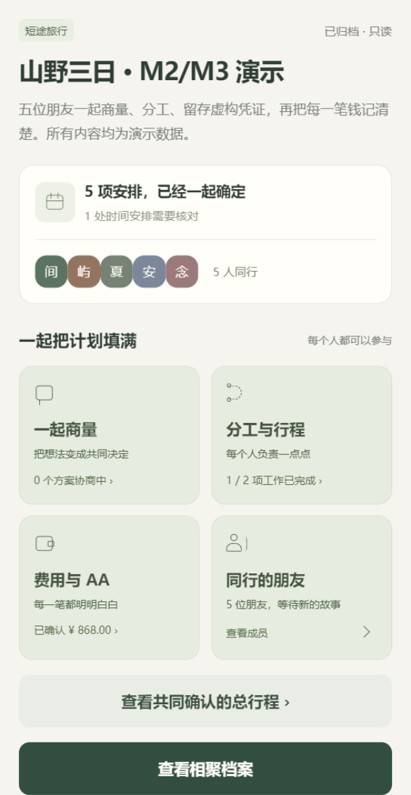

# 微信开发者工具演示

已验证环境：Windows，开发者工具 2.01.2510290，基础库 3.17.4。AppID 为项目所有者提供的 `wxf6db22d44eb01228`；无需把 AppSecret 放进前端或提交到仓库。

## 导入

1. 运行 `npm run dev:api`。
2. 运行 `npm run build:mp-weixin`，等待完成后导入 `apps/miniapp/dist/build/mp-weixin`。日常开发可用 `npm run dev:mp-weixin` 和对应 `dist/dev/mp-weixin`。
3. 开发者工具登录有该 AppID 权限的账户，开启本地“不校验合法域名”。本地默认 API 是 `http://127.0.0.1:3001`。
4. 运行 `npm run demo:m5` 准备完整数据。在登录页选择 A，再从首页打开新建活动，查看相聚档案。

`src/project.config.json` 明确 `miniprogramRoot: "./"`、`compileType: "miniprogram"` 与基础库版本。编译会复制该配置；不要把仓库根目录或 `src/` 当作小程序输出目录导入。源码配置首次新增后，已运行的开发监听进程可能需要重启才能发现复制项。

## 实际截图

以下来自微信模拟器，不是 H5 或设计稿。归档活动的 ¥868.00、五名成员及五项安排来自真实 API。

| 身份登录                                 | 已归档活动空间                                |
| ---------------------------------------- | --------------------------------------------- |
|  |  |

用户手动点击林间 A 并确认进入 ¥868.00 的归档页；采集截图时页面已回到该活动空间。后续已通过 `evaluate` 通道绕过无响应的 Page/Element RPC，使用原生查询与实际 WXML 事件完成财务回归，见 [微信接入验证](verification-wechat.md)。截图命令本身只采集画面。API 全过程、H5 异常恢复和微信手动展示的验证口径分别记录在 [M5 验收](verification-m5.md)。

## 重新截图

先在工具中开启“设置 → 安全设置 → 服务端口”，无需手填工具 HTTP 端口。默认 CLI 路径为本机安装路径，可通过环境变量修改：

```powershell
$env:WECHAT_CLI_PATH = 'D:\Program Files (x86)\Tencent\微信web开发者工具\cli.bat'
npm run wechat:capture
```

脚本打开正式构建项目并启用自动化，读取当前页面和工具版本，保存截图及不含会话令牌的元数据到 `output/wechat/`，不会关闭开发者工具。可用 `WECHAT_PROJECT_PATH` 改为开发产物路径。

若已经在自动化模式打开项目，可复用连接，避免重新打开页面：

```powershell
$env:WECHAT_WS_ENDPOINT = 'ws://127.0.0.1:9422'
npm run wechat:capture
```

这里的 9422 是本次 CLI `auto --auto-port 9422` 设置的自动化端口，与工具 HTTP 服务端口不同；下次请使用实际启用的端口。

## 本次遇到的配置读取错误

首次导入出现 `Cannot read property 'subPackages' of undefined` / `simulator not found`。已确认输出 `app.json` 可解析且 18 个页面齐全。切换稳定正式构建、显式配置根目录、重置文件索引、清理本项目编译缓存并重开后，模拟器恢复显示。

```powershell
$wechatCli = 'D:\Program Files (x86)\Tencent\微信web开发者工具\cli.bat'
$wechatProject = Join-Path $PWD 'apps/miniapp/dist/build/mp-weixin'
& $wechatCli reset-fileutils --project $wechatProject
& $wechatCli cache --clean compile --project $wechatProject
& $wechatCli close --project $wechatProject
& $wechatCli open --project $wechatProject
```

这些命令不清理登录凭据、业务存储或数据库。不要在构建正在重写产物时导入；也不要使用清空所有缓存来代替排查。

## 模拟器事件回归

保持演示 API 运行，完成构建并在工具中导入演示产物后运行 `npm run wechat:test`。脚本创建新活动，验证分享回调、账单确认、权限、冻结/重开、收款与归档。它会确认虚构演示数据的原生弹窗，不向联系人发送分享卡。复用自动化连接的方法与截图命令相同，结果保存在 `output/wechat-regression/`。真实微信身份版本的构建、启动和复测见 [接入指南](wechat-login.md)。

## 尚需真机验证

原生分享卡发送及转发、手机相册权限/取消/上传/预览、弱网与重连、真机字体和安全区，以及真机微信 code 登录。真实微信登录在开发者工具已验证。真机访问电脑需另配局域网地址或 HTTPS 后端；本机 `127.0.0.1` 不能直接复用。未上传体验版、未发布小程序。
